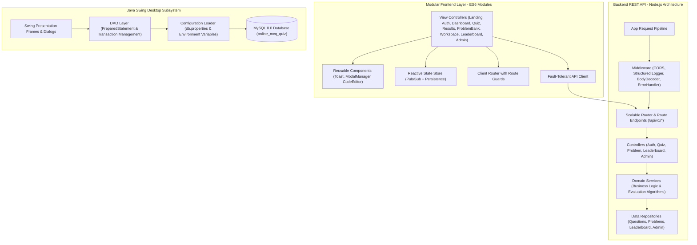

# 🏛️ CODE-ARENA System Architecture & Design Documentation

## 📑 Overview

**CODE-ARENA** is an enterprise-grade assessment and coding challenge platform engineered with a dual presentation architecture:
1. **Full-Stack Web Platform (Node.js REST API + Modular Vanilla ES6 Frontend)**: A modern, reactive, 9-screen assessment portal with an integrated algorithmic coding workspace, interactive test runner, dynamic leaderboard, and administrative management.
2. **Desktop Swing Application (Java 21 LTS + JDBC + MySQL)**: A high-performance offline assessment engine designed for college laboratories and academic assessments.

---

## 🏗️ System Architecture Diagram



---

## 📂 Clean Directory Structure

```plaintext
CODE-ARENA/
├── ARCHITECTURE.md                  # Comprehensive architectural blueprint & documentation
├── README.md                        # Master repository documentation & quickstart guide
├── run.bat                          # Master Windows launcher (Web or Java)
├── run.ps1                          # Master PowerShell launcher
│
├── OnlineMCQQuiz/                   # Java Swing Desktop Application
│   ├── build.bat / build.ps1        # Automated compilation scripts
│   ├── run.bat / run.ps1            # Application launch scripts
│   ├── config/                      # Isolated Environment Configurations
│   │   ├── db.properties            # Active local MySQL credentials
│   │   └── db.properties.example    # Configuration template
│   ├── database/                    # SQL DDL & Migration Scripts
│   │   ├── schema.sql
│   │   ├── seed_coding_problems.sql
│   │   └── upgrade_and_seed.sql
│   ├── lib/
│   │   └── mysql-connector-j-8.3.0.jar
│   └── src/com/mcq/
│       ├── Main.java                # Desktop application entry point
│       ├── database/
│       │   └── DBConnection.java    # Config-driven connection manager
│       ├── model/                   # Domain entities (Student, Question, QuizAttempt, CodingProblem)
│       ├── dao/                     # Data Access Objects (CRUD & SQL isolation)
│       ├── ui/                      # Swing Frames, Dialogs, and Java2D charts
│       └── util/                    # Timing utilities & system diagnostics
│
└── web/                             # Full-Stack Web Application & REST API
    ├── .env                         # Local environment configuration
    ├── .env.example                 # Environment variables template
    ├── package.json                 # Scripts, dependencies, and metadata
    ├── server.js                    # HTTP Server entry point
    │
    ├── server/                      # Scalable Backend REST API Architecture
    │   ├── app.js                   # Master request pipeline (static + API)
    │   ├── config/
    │   │   └── env.js               # Validated environment variables (PORT, HOST, API_PREFIX)
    │   ├── middleware/
    │   │   ├── cors.js              # Cross-Origin Resource Sharing
    │   │   ├── logger.js            # Structured request logger
    │   │   ├── bodyDecoder.js       # Asynchronous JSON body parser
    │   │   └── errorHandler.js      # Centralized error handler & JSON envelopes
    │   ├── routes/
    │   │   ├── router.js            # Scalable parameterized HTTP router
    │   │   └── apiRouter.js         # Endpoint definitions (/api/v1/*)
    │   ├── controllers/             # HTTP controller layer
    │   │   ├── authController.js
    │   │   ├── quizController.js
    │   │   ├── problemController.js
    │   │   ├── leaderboardController.js
    │   │   └── adminController.js
    │   ├── services/                # Pure domain & business logic services
    │   │   ├── authService.js
    │   │   ├── quizService.js
    │   │   ├── problemService.js
    │   │   ├── leaderboardService.js
    │   │   └── adminService.js
    │   └── data/                    # Seed repositories & data models
    │       ├── questionsData.js
    │       ├── problemsData.js
    │       ├── leaderboardData.js
    │       └── adminData.js
    │
    ├── css/
    │   └── styles.css               # Design system & responsive layout styles
    │
    └── js/                          # Modular Frontend Architecture (ES6 Modules)
        ├── main.js                  # Master bootstrap & initialization
        ├── config/
        │   └── appConfig.js         # Frontend constants & API endpoints
        ├── core/
        │   ├── store.js             # Reactive State Store (Pub/Sub pattern)
        │   ├── router.js            # Client router with route guards
        │   └── events.js            # Action type constants
        ├── api/                     # API Client Abstraction Layer
        │   ├── apiClient.js         # Fetch client with error handling
        │   ├── authApi.js
        │   ├── quizApi.js
        │   ├── problemApi.js
        │   ├── leaderboardApi.js
        │   └── adminApi.js
        ├── services/                # Pure client business logic
        │   ├── quizService.js       # Score formulas & timing algorithms
        │   ├── problemService.js    # Algorithmic heuristic validator
        │   ├── audioService.js      # Synthesized Web Audio feedback
        │   └── storageService.js    # LocalStorage serialization
        ├── components/              # Modular Reusable UI Components
        │   ├── Toast.js             # Auto-dismissing toast notifications
        │   ├── Modal.js             # Universal modal dialog manager
        │   └── CodeEditor.js        # Tab indentation & line number component
        └── views/                   # Presentation-Only View Controllers
            ├── landingView.js       # Screen 1
            ├── authView.js          # Screen 2
            ├── dashboardView.js     # Screen 3
            ├── quizView.js          # Screen 4 & Screen 7 Review
            ├── resultsView.js       # Screen 7 Scorecard
            ├── problemBankView.js   # Screen 5
            ├── workspaceView.js     # Screen 6 Split-Pane Workspace
            ├── leaderboardView.js   # Screen 8
            └── adminView.js         # Screen 9 Admin Management
```

---

## 🎯 10-Point Architectural Implementations

### 1. Clean Folder Structure
The repository strictly isolates concerns:
- **Backend API (`web/server/`)**: Follows standard microservice/Express-compatible MVC architecture (`config/`, `middleware/`, `routes/`, `controllers/`, `services/`, `data/`).
- **Frontend Client (`web/js/`)**: Decomposed into modular ES6 directories (`config/`, `core/`, `api/`, `services/`, `components/`, `views/`).
- **Java Desktop (`OnlineMCQQuiz/`)**: Separates data persistence (`dao/`), data models (`model/`), presentation (`ui/`), and configuration (`config/`).

### 2. Separation of Business Logic from UI Components
- **UI Views** (`quizView.js`, `workspaceView.js`, etc.) strictly render DOM elements and listen for DOM user events.
- **Business Logic** (scoring formulas, grade calculations, code syntax analysis, test runner simulation, timer tick management, state updates) resides in `services/quizService.js`, `services/problemService.js`, and `core/store.js`.
- **Backend Logic** is strictly encapsulated in `server/services/`, keeping HTTP controllers lightweight.

### 3. Removal of Duplicate and Dead Code
- Removed monolithic 2,215-line `web/js/app.js`.
- Replaced 6 separate modal implementations with a single, reusable `ModalManager`.
- Consolidated toast notification code into a centralized `ToastManager`.
- Centralized common formatting utilities (dates, percentages, line numbers).

### 4. Consistent Naming Conventions
- **Variables & Functions**: `camelCase` (e.g. `switchView`, `evaluateSolution`, `calculateScore`).
- **Classes & Components**: `PascalCase` (e.g. `Store`, `QuizService`, `ToastManager`, `CodeEditor`).
- **Constants**: `UPPER_SNAKE_CASE` (e.g. `ACTIONS.LOGIN_SUCCESS`, `APP_CONFIG.STORAGE_KEYS`).
- **RESTful Endpoints**: Predictable resource-oriented naming (`/api/v1/problems`, `/api/v1/quizzes`, `/api/v1/auth/login`).

### 5. Proper Error Handling Everywhere
- **Backend**: Centralized `errorHandler.js` returns uniform JSON envelopes:
  ```json
  {
    "success": false,
    "error": {
      "status": 404,
      "message": "Problem with ID 999 not found",
      "timestamp": "2026-10-22T06:30:00.000Z"
    }
  }
  ```
- **Frontend**: `apiClient.js` catches network timeouts, server errors, and provides friendly toast notifications with graceful offline fallbacks.
- **Java**: `DBConnection.java` handles `IOException` and `SQLException` gracefully, providing detailed diagnostics on startup.

### 6. Separation of Environment Configs from Code
- **Web**: `.env` and `.env.example` parsed via `server/config/env.js`. No hardcoded ports or secret strings.
- **Frontend**: `appConfig.js` resolves API base URLs dynamically.
- **Java**: `OnlineMCQQuiz/config/db.properties` and `db.properties.example` for MySQL host, port, username, and password.

### 7. Modular Reusable Components
- **`Toast`**: Self-contained notification stack with automatic timeout and sliding animation.
- **`Modal`**: Universal dialog manager supporting `open(id)`, `close(id)`, Esc key listeners, and backdrop click handling.
- **`CodeEditor`**: Reusable component handling line numbers, tab-key indentation, font-size adjustment, and theme switching.
- **`AudioService`**: Synthesizes pleasant acoustic chimes on demand using the native Web Audio API without requiring media file downloads.

### 8. Reactive State Management
Implemented a lightweight Redux/Zustand pattern in `web/js/core/store.js`:
- **State Slices**: `auth`, `currentUser`, `quiz`, `problems`, `leaderboard`, `adminQuestions`, `settings`.
- **Pure Dispatcher**: `store.dispatch(ACTION_TYPE, payload)`.
- **Pub/Sub Subscriptions**: Reactive observer notifications whenever relevant state slices mutate.
- **Persistence Layer**: Automatic synchronization of user sessions, solved challenges, and settings to `localStorage`.

### 9. Documented Codebase
- Standard JSDoc annotations across all ES6 classes, methods, and modules.
- Mermaid diagrams illustrating end-to-end data flow.
- Clear setup, configuration, and troubleshooting guides.

### 10. Scalable RESTful API Structure
Endpoints adhere to REST standards:
| Method | Endpoint | Description |
|---|---|---|
| `GET` | `/api/v1/health` | Service health status check |
| `POST` | `/api/v1/auth/login` | Student / Admin authentication |
| `POST` | `/api/v1/auth/logout` | Session termination |
| `GET` | `/api/v1/auth/profile` | Current user profile |
| `PUT` | `/api/v1/auth/profile` | Update profile information |
| `GET` | `/api/v1/quizzes` | Fetch question bank filtered by language & difficulty |
| `POST` | `/api/v1/quizzes/submit` | Evaluate quiz attempt and generate scorecard |
| `GET` | `/api/v1/problems` | List problems with search, topic, and difficulty filters |
| `GET` | `/api/v1/problems/:id` | Fetch challenge statement, test cases, and starter code |
| `POST` | `/api/v1/problems/:id/run` | Execute sample test cases |
| `POST` | `/api/v1/problems/:id/submit` | Evaluate solution against full test suites and reveal explanation |
| `GET` | `/api/v1/leaderboard` | Retrieve global student rankings |
| `GET` | `/api/v1/admin/questions` | Admin question list |
| `POST` | `/api/v1/admin/questions` | Create question |
| `PUT` | `/api/v1/admin/questions/:id` | Update question |
| `DELETE` | `/api/v1/admin/questions/:id` | Delete question |
