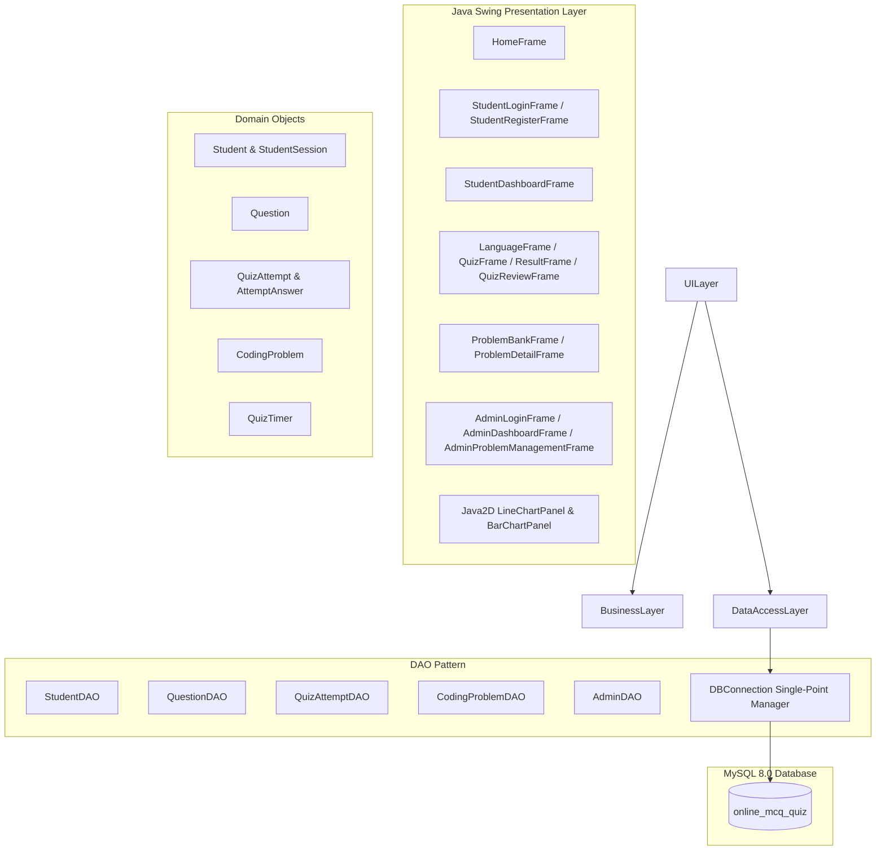

# ⚔️ CODE-ARENA: Online MCQ Quiz & Programming Problem Bank

[](https://www.oracle.com/java/)
[](https://docs.oracle.com/en/java/javase/21/docs/api/java.desktop/javax/swing/package-summary.html)
[](https://www.mysql.com/)
[](https://dev.mysql.com/doc/connector-j/en/)
[](#-system-architecture)

**CODE-ARENA** is a standalone, full-featured desktop assessment and interactive coding platform engineered in **Java Swing** with **JDBC** and **MySQL**. It bridges theoretical concept evaluation with practical algorithmic problem-solving through two integrated environments:
1. **Interactive MCQ Assessment Engine**: Adaptive quizzes across multiple languages, time-constrained testing, custom Java2D analytics charts, and question-by-question review with detailed explanations.
2. **Algorithmic Problem Bank**: LeetCode-style coding challenges with problem statements, constraints, sample test cases, starter code, and progress tracking.

---

## 📑 Table of Contents

- [🌟 Key Modules & Features](#-key-modules--features)
  - [1. Student Learning & Performance Portal](#1-student-learning--performance-portal)
  - [2. MCQ Quiz Assessment Engine](#2-mcq-quiz-assessment-engine)
  - [3. Programming Problem Bank](#3-programming-problem-bank)
  - [4. Academic Administration Portal](#4-academic-administration-portal)
- [🏗️ System Architecture](#️-system-architecture)
- [🏛️ Architecture Blueprint (ARCHITECTURE.md)](ARCHITECTURE.md)
- [📂 Repository Directory Structure](#-repository-directory-structure)
- [🗄️ Database Schema & Relational Design](#️-database-schema--relational-design)
- [🚀 Quickstart Guide](#-quickstart-guide)
  - [Prerequisites](#prerequisites)
  - [Database Initialization](#1-database-initialization)
  - [Configuration](#2-database-configuration)
  - [Build & Run](#3-build--run)
- [🔑 Default System Credentials](#-default-system-credentials)
- [🛠️ Technology Stack](#️-technology-stack)

---

## 🌟 Key Modules & Features

### 1. Student Learning & Performance Portal
- **Authentication & Profiles**: Secure student registration and sign-in backed by relational database persistence.
- **KPI Metrics Cards**: Immediate dashboard display of quizzes taken, average percentage, top-performing subject, and total algorithmic challenges solved.
- **Java2D Analytics Visualizations**:
  - **Score Progression Chart**: Custom anti-aliased line graph tracking performance curves across attempts with chronological date stamps.
  - **Topic Mastery Breakdown**: Dynamic horizontal bar chart color-coded by mastery thresholds (Green $\ge 80\%$, Blue $60-79\%$, Amber $40-59\%$, Red $<40\%$).
- **Historical Attempt Auditing**: Detailed log of past quiz sessions with timestamps, scores, and one-click access to review past question sets.

### 2. MCQ Quiz Assessment Engine
- **Multi-Language Coverage**: Rich question repositories covering **Java**, **JavaScript**, **HTML**, and **CSS**.
- **Tiered Difficulty Levels**:
  - `Beginner`: Core syntax, keywords, and foundational primitives (1 Mark).
  - `Intermediate`: Language idioms, APIs, and OOP patterns (2 Marks).
  - `Advanced`: Concurrency, edge cases, and memory architecture (3 Marks).
- **Time-Constrained Testing**: Per-question 30-second countdown managed via `javax.swing.Timer` with real-time UI gauge and automatic advancement.
- **In-Depth Answer Review**: Post-quiz breakdown visually flagging selected answers vs. correct options alongside comprehensive pedagogical explanations.

### 3. Programming Problem Bank
- **Curated Problem Repository**: Seeded algorithmic challenges (Array manipulation, String parsing, Two Pointers, Data Structure implementations, and OOP design).
- **Split-Pane Coding Workspace**:
  - Left pane: Markdown-like challenge statement, time/space constraints, formatted test cases with copy buttons, and solution hints.
  - Right pane: Monospaced code editor pre-populated with starter code signatures.
- **Status Tracking**: Problems dynamically marked as `Solved`, `Attempted`, or `Bookmarked` per student.

### 4. Academic Administration Portal
- **Question Bank CRUD**: Add, edit, preview, and purge questions across all languages and difficulty tiers.
- **Challenge Authoring Suite**: Form-based interface to publish, modify, and manage coding problems in the problem bank.
- **Data Safety**: All queries enforced via JDBC `PreparedStatement` to guarantee SQL-injection immunity.

---

## 🏗️ System Architecture

CODE-ARENA follows the **Model-View-DAO (Data Access Object)** design pattern for strict separation of concerns:



---

## 📂 Repository Directory Structure

```plaintext
CODE-ARENA/
├── ARCHITECTURE.md                              # Detailed architectural specifications & design patterns
├── README.md                                    # Master workspace documentation
├── run.bat / run.ps1                            # Master dual launcher (Web application & Java Desktop)
│
├── OnlineMCQQuiz/                               # Java Swing Desktop Application
│   ├── build.bat / build.ps1                    # One-click automated compilation scripts
│   ├── run.bat / run.ps1                        # Desktop launch scripts
│   ├── config/                                  # Decoupled database environment settings
│   │   ├── db.properties                        # Local MySQL credentials
│   │   └── db.properties.example                # Configuration template
│   ├── lib/                                     # MySQL Connector/J driver
│   ├── database/                                # Relational schema & migration seed scripts
│   └── src/com/mcq/                             # Model-View-DAO Java packages
│
└── web/                                         # Full-Stack Web Platform & REST API
    ├── .env / .env.example                      # Decoupled server environment configurations
    ├── server.js                                # Node.js Master Server entry point
    ├── server/                                  # Scalable REST API Architecture (/api/v1/*)
    │   ├── config/                              # Environment validation (env.js)
    │   ├── middleware/                          # CORS, Logger, BodyDecoder, ErrorHandler
    │   ├── routes/                              # Parameterized router & route definitions
    │   ├── controllers/                         # HTTP controllers (Auth, Quiz, Problems, Admin)
    │   ├── services/                            # Domain services & scoring logic
    │   └── data/                                # Curated datasets (Questions, Problems, Leaderboard)
    ├── css/                                     # Stylesheets & theme system
    └── js/                                      # Modular ES6 Frontend Architecture
        ├── main.js                              # Application entry point & window bridge
        ├── config/                              # Frontend configuration (appConfig.js)
        ├── core/                                # Reactive Store (Pub/Sub) & Client Router
        ├── api/                                 # Fault-tolerant API Client layer
        ├── services/                            # Frontend domain logic & Web Audio synthesizer
        ├── components/                          # Reusable components (Toast, Modal, CodeEditor)
        └── views/                               # View controllers (Landing, Quiz, Workspace, Admin)
```

---

## 🗄️ Database Schema & Relational Design

The system runs on the `online_mcq_quiz` database in MySQL. Key tables and relations include:

| Table | Purpose | Primary Key | Key Foreign Keys |
|---|---|---|---|
| `admin` | Instructor authentication credentials | `id` | - |
| `students` | Learner profiles and account credentials | `id` | - |
| `questions` | Bank of MCQs with language, topic, options, correct answer, and explanation | `id` | - |
| `quiz_attempts` | Summary records for each assessment attempt | `id` | `student_id` $\rightarrow$ `students(id)` |
| `attempt_answers` | Granular response tracking per question per quiz attempt | `id` | `attempt_id` $\rightarrow$ `quiz_attempts(id)`, `question_id` $\rightarrow$ `questions(id)` |
| `coding_problems` | Coding challenges, descriptions, constraints, I/O samples, and starter code | `id` | - |
| `student_problem_solutions` | User code submissions, problem statuses (`Solved`, `Attempted`), timestamps | `id` | `student_id` $\rightarrow$ `students(id)`, `problem_id` $\rightarrow$ `coding_problems(id)` |

---

## 🚀 Quickstart Guide

### Prerequisites
1. **Java Development Kit (JDK 21 LTS or newer)** installed and available on your system `PATH`:
   ```powershell
   java -version
   javac -version
   ```
2. **MySQL Server 8.0+** running locally (default port `3306`).

---

### 1. Database Initialization

Open your MySQL client or MySQL Workbench and run the setup script:

```sql
SOURCE d:/CODE-ARENA/OnlineMCQQuiz/database/upgrade_and_seed.sql;
```

*Alternatively, from PowerShell / Command Prompt:*
```powershell
mysql -u root -p < d:\CODE-ARENA\OnlineMCQQuiz\database\upgrade_and_seed.sql
```

---

### 2. Environment Configuration

#### Java Swing Desktop Database Configuration:
Configure your local MySQL credentials in [db.properties](file:///d:/MCA%20FINAL%20YEAR%20PROJECT/CODE-ARENA/OnlineMCQQuiz/config/db.properties):

```properties
db.host=localhost
db.port=3306
db.name=online_mcq_quiz
db.user=root
db.password=YOUR_MYSQL_PASSWORD
```

> [!TIP]
> Credentials can also be dynamically passed through the `MYSQL_PASSWORD`, `MYSQL_USER`, and `MYSQL_URL` environment variables.

#### Web Platform Environment Configuration:
Configure server port and API settings in [web/.env](file:///d:/MCA%20FINAL%20YEAR%20PROJECT/CODE-ARENA/web/.env):

```env
PORT=3000
HOST=localhost
NODE_ENV=development
API_PREFIX=/api/v1
```

---

### 3. Build & Run

#### Quick Launch via Master Launcher (Root):
From the project root directory, run:
```cmd
run.bat web     # Starts Full-Stack Web Platform at http://localhost:3000/
run.bat java    # Starts Java Swing Desktop Application
```

#### Or Using PowerShell:
```powershell
.\run.ps1 web   # Launch Modern Web Application
.\run.ps1 java  # Launch Java Swing Desktop Application
```

#### Manual Compilation & Execution:
```powershell
# Compile
javac -cp "lib\mysql-connector-j-8.3.0.jar" -d bin (Get-ChildItem -Path src -Recurse -Filter *.java | ForEach-Object { $_.FullName })

# Run
java -cp "bin;lib\mysql-connector-j-8.3.0.jar" com.mcq.Main
```

---

## 🔑 Default System Credentials

| Role | Username | Password | Notes |
|---|---|---|---|
| **Student** | `student` | `student123` | Pre-seeded with historical quiz attempts & solved problems |
| **Admin** | `admin` | `admin123` | Full access to add/edit/delete MCQs and coding challenges |
| *New Student* | *Self-register* | *Custom* | Register instantly via "Create New Account" in the student portal |

---

## 🛠️ Technology Stack

- **Platform**: Java SE (JDK 21 LTS)
- **GUI Toolkit**: Java Swing (`JFrame`, `JPanel`, `JSplitPane`, `JTabbedPane`, `JTable`) & Java2D (`Graphics2D`, anti-aliased geometry, gradient painting)
- **Database Engine**: MySQL Server 8.0+
- **Database Connectivity**: JDBC (`java.sql.Connection`, `PreparedStatement`, `ResultSet`, transactional commit/rollback)
- **Driver**: MySQL Connector/J 8.3.0
- **Design Pattern**: Model-View-DAO Architecture
